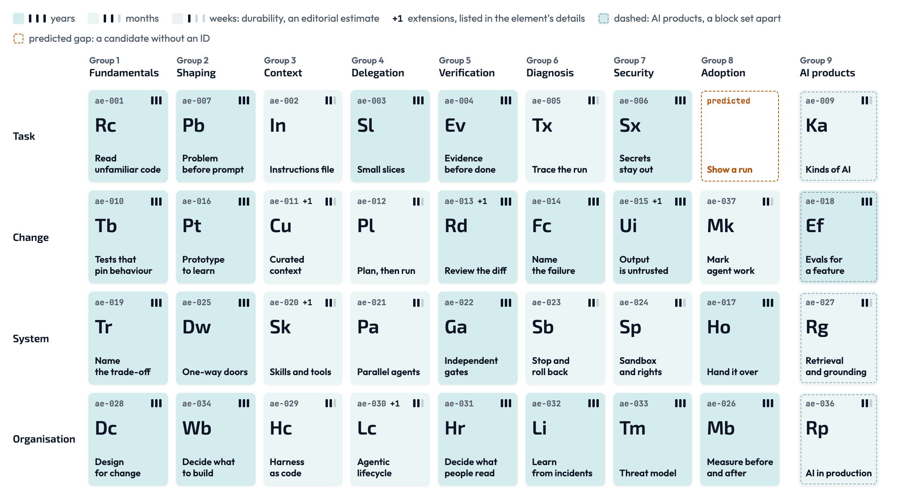

# Agentic Engineering Periodic System

By Damir Majer, ASE Academy. Release 2026.4.1, 2026-10-22.

A map of the practices that let a team build software with coding agents and
keep it working. 35 elements and 5 extensions, in
9 groups and 4 rows. Every element states a recurring problem
and an observable test: how you see on your own code that the problem is
handled.

The interactive table: https://ase.academy/agentic-engineering/periodic-system/

[](https://ase.academy/agentic-engineering/periodic-system/)

## In your AI assistant

A free, read-only MCP server hands the table to your assistant: the elements,
how to check each test clause by clause, and the reading rules. Add a remote
(HTTP) MCP server with this address; in Claude Code:

```
claude mcp add --transport http periodic-system https://ase.academy/mcp
```

In Codex:

```
codex mcp add periodic-system --url https://ase.academy/mcp
```

Then ask, in a repository: "Check this repository against the Agentic
Engineering Periodic System." Your assistant reads your files itself; the server
does not ask for your code and does not keep what you send. Other tools (Cursor,
VS Code and more): https://ase.academy/mcp

## What is in this repository

| File                                         | What it holds                                                                           |
| -------------------------------------------- | --------------------------------------------------------------------------------------- |
| [`agent-reference.md`](agent-reference.md)   | The whole table as one readable list, with the reading guide first. Start here.         |
| [`data/elements.json`](data/elements.json)   | Every element: problem, observable test, when it applies, when it adds work, activities |
| [`data/clauses.json`](data/clauses.json)     | Tests split into clauses, with the kind of evidence each clause needs                   |
| [`data/relations.json`](data/relations.json) | Pairs of elements that are read together, with when, why and the limit                  |
| [`data/catalogue.json`](data/catalogue.json) | Columns, rows, roles and the gaps in the grid                                           |
| [`CITATION.cff`](CITATION.cff)               | How to cite this release                                                                |
| [`CHANGELOG.md`](CHANGELOG.md)               | What changed in each release                                                            |

Element IDs (`ae-006`) are stable. An ID is never renumbered or reused; a
retired element keeps its ID and points to the element that replaces it.

## How it was made

Curation and internal research by Damir Majer, from practitioner reports and
published research on building software with coding agents. Drafted with AI
assistance, reviewed and edited by Damir Majer.

This is one practitioner's map. It is not a standard, a certification or a
complete list, and it is general information, not advice for a particular
project.

## Licence

All content in this repository is licensed under
[CC BY 4.0](https://creativecommons.org/licenses/by/4.0/)
([`LICENSE`](LICENSE)). You may share and adapt it, also commercially, if you
give credit, link the licence and say what you changed. Attribution example:

> Agentic Engineering Periodic System, release 2026.4.1, by Damir Majer (ASE
> Academy), https://github.com/damir-majer/agentic-engineering-periodic-system, CC BY 4.0.

The name "ASE Academy" and its logo are not covered by the licence.

## Contributions

This repository does not take pull requests, issues or discussions. Releases are
published here when they are ready. Corrections are welcome by email, using the
contact details in the [Impressum](https://ase.academy/impressum).

## Liability

The content is provided free of charge. Liability is limited to intent and gross
negligence. Liability for injury to life, body or health and under the Product
Liability Act is not affected.

Published by Damir Majer. [Impressum](https://ase.academy/impressum)
